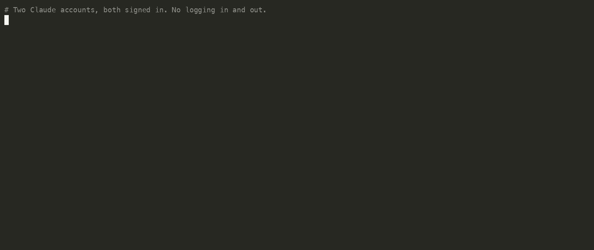
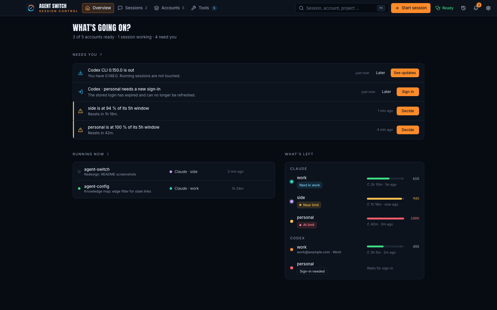
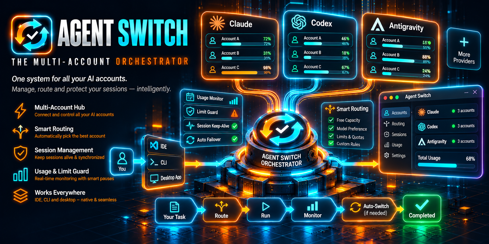

<p align="center">
  <a href="https://event4u-app.github.io/agent-switch/">
    
  </a>
</p>

<h1 align="center">Agent Switch</h1>

<p align="center">
  <b>All your AI coding accounts, signed in side by side —<br>and every session on the one with the most left.</b>
</p>

<p align="center">
  <a href="https://www.npmjs.com/package/@event4u/agent-switch"></a>
  <a href="https://www.npmjs.com/package/@event4u/agent-switch"></a>
  <a href="https://github.com/event4u-app/agent-switch/actions/workflows/ci.yml"></a>
  <a href="https://event4u-app.github.io/agent-switch/"></a>
  <a href="https://github.com/event4u-app/agent-switch/blob/main/LICENSE"></a>
</p>

<p align="center">
  Claude Code · Codex · Antigravity — macOS, Linux and Windows
</p>

## Sound familiar?

- **"I keep logging out and back in to switch accounts."**
  Every account stays signed in, side by side. Switching never logs anyone out.
- **"One account hits its limit mid-task while the other resets unused."**
  Each new session starts on the account that would otherwise waste the most of
  its quota at its next reset.
- **"I never know which account has what left."**
  The menu-bar app shows every account's 5-hour and weekly limit, live.
- **"Client work ends up on my personal account."**
  Pin a folder to an account once, and every session started there uses it.

## Quick start — 60 seconds

**1. Install** (Node 20 or newer):

```bash
npm install -g @event4u/agent-switch
```

**2. Add each account once.** Each one opens the provider's normal sign-in in
your browser:

```bash
agent-switch add work
agent-switch add personal
```

**3. Turn it on.** This adds the shell wrapper and the background service that
keeps usage numbers fresh:

```bash
agent-switch shellenv install
agent-switch service install
```

Open a new terminal and run `claude` as always. It starts on the account with
the most to give. Want to see it? Run `agent-switch`: the desktop app opens,
with no installer needed.

<p align="center">
  
</p>

> Codex: add `--provider codex` to `add`. Already signed in to Claude Code? See
> [keeping your current login](https://event4u-app.github.io/agent-switch/start-here/quick-start/#keep-the-login-you-already-have).

## What you get

### Never log in twice

Each account gets its own folder with its own login, the way the provider
intended. agent-switch only decides which folder the next session uses. It
never copies, swaps or rotates a login. Nothing goes stale when you switch, and
running sessions are never touched. With the background service, idle Claude
logins are kept fresh without spending any quota.

### Never waste a paid limit

With no folder rule, a new session is balanced across your accounts. It goes to
the one that would lose the most of what is left at its next reset, so every
plan gets used before it resets. An account at its limit is skipped. Folder
rules pin a project to one account or to a group of accounts. Ask
`agent-switch dir --json` for any folder, and it tells you which account it
would pick and why.

### See everything, move anything

<p align="center">
  
</p>

The desktop app and its menu-bar popover show every account's limits, every
running session with its context %, and the one thing that needs you next. Move
a session to another account and continue it there (`takeover`). On macOS you
can even switch the account of a session that is still running (`rebind`), right
now or when its current turn ends.

## How it fits together

<p align="center">
  
</p>

## Your logins stay yours

agent-switch is not a proxy and has no server, no account and no telemetry.
Logins stay where the provider put them. Over the internet it only talks to:

- the provider's own usage endpoint, with your own login;
- GitHub, for releases and the desktop app download;
- npm, for update checks of agent-switch's tools (the desktop app checks the
  `claude` and `codex` CLIs).

It switches a running session only when you confirm.
[What agent-switch reads, stores and sends →](https://event4u-app.github.io/agent-switch/trust/security-and-privacy/)

## What works where

| | Claude Code | Codex | Antigravity |
|---|:-:|:-:|:-:|
| Several accounts signed in at once | ✅ | ✅ | ✅ |
| Usage meters and balanced starts | ✅ | ✅ | ➖ |
| Pin folders to accounts | ✅ | ✅ | ✅ |
| Move a session to another account | ✅ | ✅ | ➖ |
| Switch a running session's account | ✅ macOS | ➖ | ➖ |
| Logins kept fresh in the background | ✅ | ➖ | ➖ |

Antigravity accounts work with `--provider antigravity`. The desktop app shows
Claude Code and Codex by default; show Antigravity there with
`agent-switch providers enable --provider antigravity`. The core works on
macOS, Linux and Windows, in zsh, bash, fish and PowerShell. The
[platform matrix](https://event4u-app.github.io/agent-switch/reference/platform-matrix/)
lists every exception.

## Everyday commands

```bash
asw                        # list your accounts (* = the one you prefer)
asw work                   # prefer "work" when the accounts are level
agent-switch run personal  # one session on "personal", whatever the balance says
agent-switch map work ~/code/client-a   # this folder always uses "work"
agent-switch status        # every account's limits
agent-switch doctor        # check the setup
```

The [CLI reference](https://event4u-app.github.io/agent-switch/reference/cli/)
lists every command.

## Documentation

- **[Quick start](https://event4u-app.github.io/agent-switch/start-here/quick-start/)**:
  the three steps above, per shell and OS.
- **[Which account a session uses](https://event4u-app.github.io/agent-switch/concepts/which-account/)**:
  folder rules, balanced starts and your preferred account.
- **[The desktop app](https://event4u-app.github.io/agent-switch/guides/desktop-app/)**:
  overview, sessions, notifications and the desktop pet.
- **[Move a session](https://event4u-app.github.io/agent-switch/guides/move-a-session/)**:
  take over, live switch and hand off.
- **[Troubleshooting & FAQ](https://event4u-app.github.io/agent-switch/reference/troubleshooting/)**
- **[What agent-switch will never do](NON-GOALS.md)**: no proxy, no
  fingerprinting, no pooling of free tiers.

## Update and uninstall

`agent-switch update` installs the latest version through npm. The desktop app
updates itself. What changed in each version is in the
[release notes](https://github.com/event4u-app/agent-switch/releases). `agent-switch uninstall` removes its profiles, their stored
logins, the background service and the app launchers. Your default Claude Code,
Codex and Antigravity installs are untouched. Remove the `shellenv` line from
your shell's startup file yourself.
[Details →](https://event4u-app.github.io/agent-switch/start-here/install/#uninstall)

## Contributing

Issues and pull requests are welcome. To build from source:

```bash
npm ci && npm run build && npm link
npm test
```

The desktop app lives in [`gui/`](gui/) (Tauri + React). The docs site lives in
[`starlight/`](starlight/).

If agent-switch saves you a login or a wasted limit, a ⭐ on GitHub helps others
find it.

## License

[MIT](LICENSE) © [event4u](https://event4u.app)
