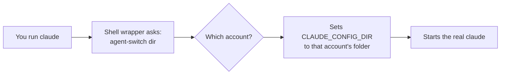

import { Aside, FileTree, CardGrid, LinkCard } from '@astrojs/starlight/components';

Agent Switch does not log you in, proxy your traffic or swap logins. It does one
small thing at the right moment: when you start `claude`, `codex` or `agy`, it
tells the tool which folder to use. Every account lives in its own folder, so
every account stays signed in.

## One folder per account

Each AI coding tool reads its settings and login from a folder, and an
environment variable can point it somewhere else. Agent Switch creates one such
folder per account under `~/.agent-switch`:

<FileTree>
- ~/.agent-switch/
  - claude/
    - work/config/ the folder `CLAUDE_CONFIG_DIR` points at for "work"
    - personal/config/
  - codex/
    - work/config/ the folder `CODEX_HOME` points at
  - antigravity/
    - work/config/ used as `HOME` for `agy`
</FileTree>

| Tool | What Agent Switch sets | Where that account's login lives |
|---|---|---|
| Claude Code | `CLAUDE_CONFIG_DIR` | macOS: a keychain entry Claude Code derives from the folder path. Linux and Windows: `.credentials.json` inside the folder. |
| Codex | `CODEX_HOME` | `auth.json` inside the folder. |
| Antigravity | `HOME` | macOS: a keychain inside the folder. |

Because each folder has its own login, each account signs in once and then
refreshes itself, independently of the others. That is why nothing goes stale
when you switch.

## What happens when you start a session

1. The shell wrapper (added by `agent-switch shellenv`) runs before the real
   binary and asks `agent-switch dir` which account to use for the current
   folder.
2. `dir` answers from a folder rule, a balanced pick or your preferred account.
   [Which account a session uses](/agent-switch/concepts/which-account/)
   explains the order.
3. The wrapper exports that account's folder and starts the real tool. From
   then on, the tool talks to its provider directly, exactly as without Agent
   Switch.

If Agent Switch is missing or fails, the wrapper starts the real tool anyway. A
start is only stopped when you ask for that: a folder rule that points at a
disabled account or an unusable pool refuses the start, and says why.

## Running sessions are never touched

A tool reads its folder when it starts. Changing your preferred account, adding
a folder rule or balancing only affects **new** sessions. The two exceptions are
explicit and need your confirmation: moving a session with `takeover`, and
switching a running Claude session with `rebind`. See
[Move a session](/agent-switch/guides/move-a-session/).

## Where the usage numbers come from

To balance sessions and show what is left, Agent Switch reads each account's
usage from the provider's own usage endpoint, with that account's own login. It
does this in the background service and in the desktop app, and stores only
the numbers, never a token. Claude Code and Codex report usage. Antigravity does
not, so it shows no limits.

<Aside type="note">
  Only two commands ever write a login: `import` (copies the login you already
  have into a new account) and `rebind` (switches a running session's account).
  Both run only when you call them. Everything else reads.
  [Security & privacy](/agent-switch/trust/security-and-privacy/) has the full
  picture.
</Aside>

## Next steps

<CardGrid>
  <LinkCard title="Which account a session uses" href="/agent-switch/concepts/which-account/" description="Folder rules, balanced starts and your preferred account." />
  <LinkCard title="Security & privacy" href="/agent-switch/trust/security-and-privacy/" description="What is read, stored and sent." />
</CardGrid>
