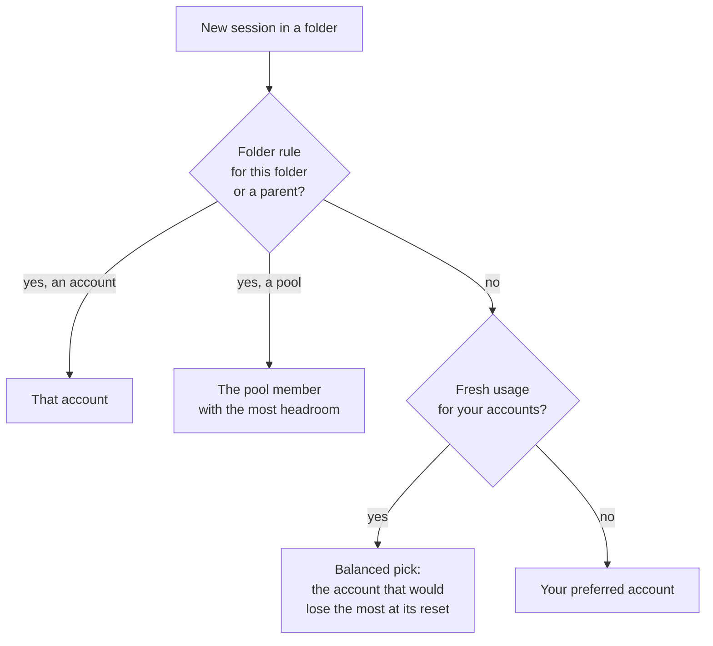

import { Aside, Steps, CardGrid, LinkCard } from '@astrojs/starlight/components';

Every time you start `claude` or `codex`, Agent Switch picks an account in a
fixed order. You can always see the pick and the reason before you start.

## The order



1. **Folder rule.** If the folder, or the nearest parent folder, is pinned to
   an account, that account is used. A rule can also point at a pool, a group
   of accounts; then the member with the most headroom is used.
   See [Projects & pools](/agent-switch/guides/projects-and-pools/).
2. **Balanced pick.** Without a rule, the start is balanced across all enabled
   accounts of that tool. It goes to the account that would lose the most of
   what is left at its next reset.
3. **Your preferred account.** When the accounts are level, or no usage numbers
   are fresh, the start uses your preferred account: the one you set with
   `asw <name>` (or `agent-switch use <name>`), marked with `*` in `asw`.

<Aside type="note" title="`use` is a preference, not a lock">
  `agent-switch use work` does not force every session onto `work`. It marks
  `work` as the account to fall back on. To force one session onto an account,
  use `agent-switch run work`. To force a folder, use a folder rule.
</Aside>

## How the balanced pick weighs accounts

Each account has a weekly limit that resets at a known time. For every account
Agent Switch asks: *how fast would I have to use what is left to use all of it
before it resets?* The account with the highest pace wins, because its quota is
the most at risk of being wasted.

| Account | Left this week | Resets in | Pace to use it up |
|---|---|---|---|
| `work` | 19 % | 5 days | 0.2 % per hour |
| `personal` | 66 % | 14 hours | 4.7 % per hour |

Here `personal` wins. Using it now spends quota that would otherwise be gone in
14 hours, while `work` still has days to be used.

An account is never picked when:

- it is at or over its [limit protection](/agent-switch/concepts/limits-and-protection/)
  threshold in any window;
- it is disabled, signed out, or shares its login with your default install
  (see [Keep the login you already have](/agent-switch/start-here/quick-start/#keep-the-login-you-already-have));
- its usage is unknown. Unknown is never treated as free.

## Fresh numbers matter

The pick only trusts usage that is at most 10 minutes old. The background
service refreshes every enabled account every 5 minutes, and every refresh in
the desktop app counts too. Without either, there are no fresh numbers, and
every start uses your preferred account. Install the service once:

```bash
agent-switch service install
```

## See the pick, and why

<Steps>

1. **Before a start** — ask for the current folder:

   ```bash
   agent-switch dir --json
   ```

   ```json
   {
     "profile": "claude/personal",
     "why": [
       "No folder rule — balancing across 2 claude accounts by what each would lose at its reset",
       "Picked claude/personal: 66% of the week left, resets in 14 h (4.7 %/h to use it up) · usage checked just now — ahead of claude/work (0.2 %/h)"
     ]
   }
   ```

2. **After starts** — list what each wrapped start chose and why:

   ```bash
   agent-switch picks
   ```

</Steps>

## When the account is already busy

By default an account can run several sessions at once. They share its limits.
With `agent-switch guard block`, a new start avoids an account that already has
a running session and takes the best free account instead, and says so. When
every account is busy, it shares the best one rather than refusing.
`guard warn` (the default for new installs) only tells you; `guard off` says
nothing. See [Sessions & context](/agent-switch/concepts/sessions-and-context/#one-account-one-session).

## Next steps

<CardGrid>
  <LinkCard title="Projects & pools" href="/agent-switch/guides/projects-and-pools/" description="Pin folders to accounts or to a group of accounts." />
  <LinkCard title="Limits & protection" href="/agent-switch/concepts/limits-and-protection/" description="When an account is too full to be picked." />
</CardGrid>
